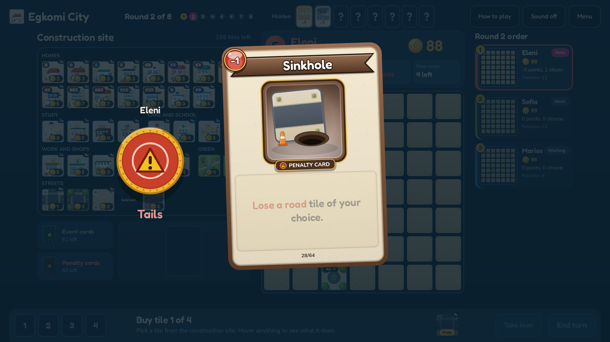

  

<h1 align="center">Egkomi City</h1>

  A city-building board game about streets, shade and green space in Egkomi, Nicosia. 
  1 to 4 players on one computer.

  <a href="https://github.com/11samy02/egkomi-city/releases/latest"><b>Download 2.0 for Windows</b></a>

---

## How it plays

Every round, each planner buys 4 tiles from a shared construction site and builds them on their own 7x7 city. Homes bring citizens. Everything else keeps them happy.

- **Six kinds of citizen**: students, workers, children, older residents, residents with a disability and expats. Each one needs two things nearby (a university and a library, a school and a park, a clinic and a market...), likes a few others, and dislikes one.
- **Roads** link homes to the places their citizens need. A long walk with no shade heats them up.
- **Parks and trees** cheer up neighbours, clean the air and shade the roads.
- **Pollution** starts high and drags everyone's mood down until you plant green.
- **Pricier is better**: a hospital or a supermarket does the same job as a clinic or a market, and also gives +1 happiness to every citizen it serves.
- **Gold** is tight. A loan helps now but costs more points with every one you take.
- **Cards**: every turn a coin flip picks an event or a penalty card. Hidden circumstance cards, like a heatwave or a flu wave, are revealed round by round and change the rules for everyone.

After 8 rounds every citizen scores their happiness, from -5 to +5. A mix of happy citizens earns a variety bonus. The happiest city wins.

  

<table>
  <tr>
    <td></td>
    <td></td>
  </tr>
  <tr>
    <td colspan="2"></td>
  </tr>
</table>

## Features

- Pass-and-play for 2 to 4 people, or play solo against Easy, Medium and Hard bots that plan whole cities
- 128 event and penalty cards, plus 32 hidden circumstances
- Hover any tile to see exactly what it does in your city right now
- Points preview before you build, with live routes, shade and citizen moods
- "Name the one change" at the end: each planner picks what would have added the most points
- Full mouse or keyboard control
- Options for fullscreen, volume, bot speed and animation speed

## Play

1. Download the zip from the [latest release](https://github.com/11samy02/egkomi-city/releases/latest).
2. Unzip it and run `EgkomiCity.exe`.

Windows 10 or 11, 64-bit. Nothing to install. The **How to play** screen in the game explains every rule.

Fonts: Fredoka and Nunito, SIL Open Font License.
