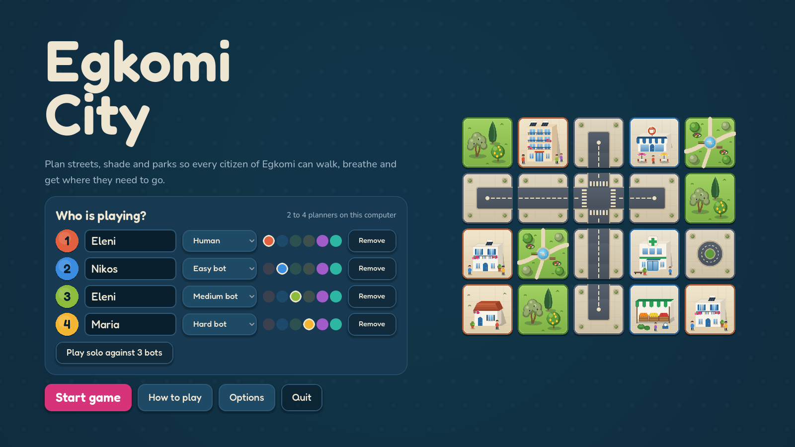
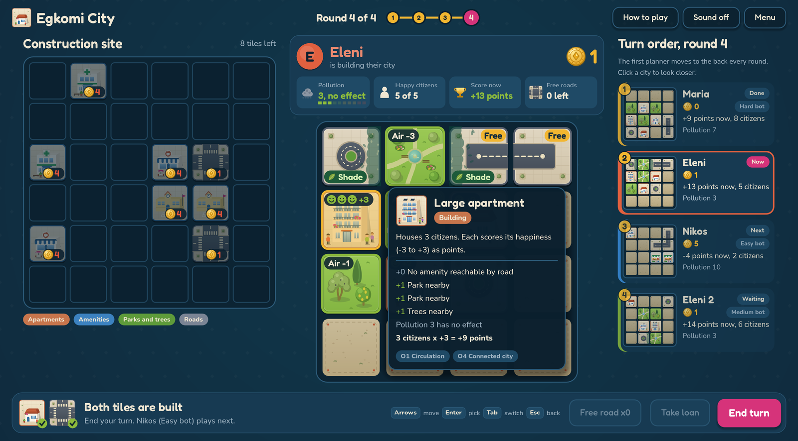
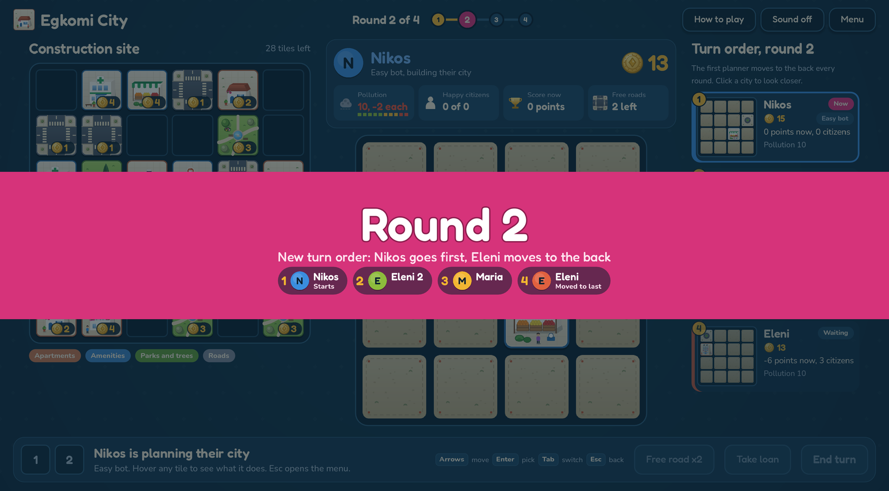
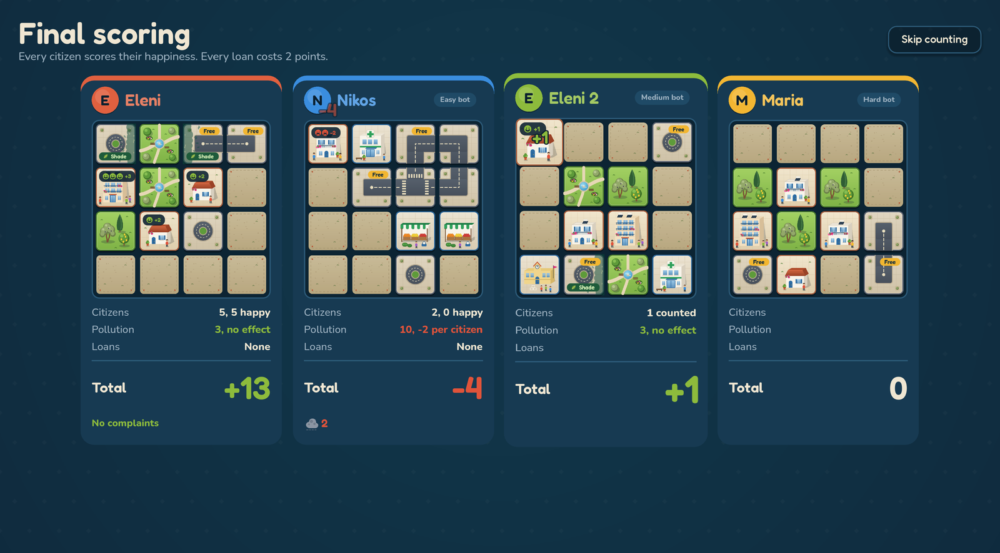

  

<h1 align="center">Egkomi City</h1>

  A city-building board game about streets, shade and green space in Egkomi, Nicosia. 
  1 to 4 players on one computer.

  <a href="https://github.com/11samy02/egkomi-city/releases/latest"><b>Download for Windows</b></a>

---

## How it plays

Every round, each planner buys 2 tiles from a shared construction site and builds them on their own 4x4 city. Apartments bring citizens. Amenities, parks, trees and roads keep them happy.

- **Roads** link homes to cafés, clinics, schools and markets.
- **Parks and trees** cheer up neighbours, clean the air and shade long walks.
- **Pollution** starts high and drags everyone's mood down until you plant green.
- **Gold** is tight. A loan helps now but costs points at the end.

After 4 rounds every citizen scores their happiness, from -3 to +3. The happiest city wins.

  

<table>
  <tr>
    <td></td>
    <td></td>
  </tr>
</table>

## Features

- Pass-and-play for 2 to 4 people, or play solo against Easy, Medium and Hard bots
- Hover any tile to see exactly what it does in your city right now
- Points preview before you build, with live routes, shade and citizen moods
- Full mouse or keyboard control
- Options for fullscreen, volume, bot speed and animation speed

## Play

1. Download the zip from the [latest release](https://github.com/11samy02/egkomi-city/releases/latest).
2. Unzip it and run `EgkomiCity.exe`.

Windows 10 or 11, 64-bit. Nothing to install. The **How to play** screen in the game explains every rule.

Fonts: Fredoka and Nunito, SIL Open Font License.
